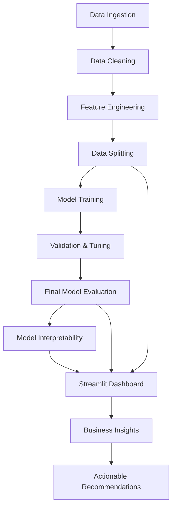

# Customer Churn Prediction & Business Analytics

📊 **End-to-end data science project** predicting customer churn with interpretable ML models and an interactive Streamlit dashboard for the Telco industry.

## 🎯 Project Overview
This comprehensive data science project leverages machine learning and business analytics to identify customers at risk of churn, enabling targeted retention strategies. The model achieves strong predictive performance while maintaining interpretability for actionable business insights.

## 💼 Business Problem
**Challenge:** Identify customers likely to churn within 30-60 days to enable proactive retention interventions.

**Impact:** High churn directly impacts revenue and customer lifetime value. Understanding churn drivers enables data-driven retention strategies that can significantly improve customer loyalty and reduce revenue loss.

**Business Context:** The telecommunications industry faces intense competition where customer retention is more cost-effective than acquisition. Month-to-month contracts and high-value customers are particularly vulnerable.

## 🎯 Project Objectives
1. **Build Predictive Model:** Develop an ML model to predict customer churn with high accuracy
2. **Ensure Interpretability:** Create explainable model insights for business stakeholders
3. **Deliver Business Dashboard:** Provide an interactive web interface for prediction and analytics
4. **Generate Actionable Insights:** Identify key churn drivers and recommend retention strategies
5. **Create Reproducible Pipeline:** Establish end-to-end workflow from data to production

## 📊 Dataset
| Attribute | Details |
|-----------|---------|
| **Source** | IBM Telco Customer Churn dataset (Kaggle) |
| **Size** | 7,043 customer records |
| **Features** | 21 total (1 identifier + 20 predictive features) |
| **Target** | Customer churn (binary: Yes/No) |
| **Class Balance** | 73.5% non-churn, 26.5% churn (moderately imbalanced) |
| **Data Quality** | 0 missing values, 0 duplicate records after cleaning |

### Data Provenance & License

This project uses the **IBM Telco Customer Churn** sample dataset, a publicly
available research dataset. It contains **no real customer data and no personally
identifiable information**.

- **Original source:** https://www.kaggle.com/datasets/blastchar/telco-customer-churn
- **`customerID` is a synthetic identifier** generated by IBM for the public sample
  (format `XXXX-XXXXX`). It is not a real account, customer, or person, and carries
  no meaning outside this dataset.
- **`data/processed/cleaned.csv` is fully reproducible** from the original download
  via `python src/clean_data.py`. The only transformations applied are documented in
  `reports/data_cleaning.md`: `TotalCharges` whitespace-to-numeric conversion and
  `SeniorCitizen` int-to-bool conversion. Row order and all other values are unchanged.
- The raw download (`data/raw/telco_churn.csv`) is **not** committed; it is excluded
  via `.gitignore`. Download it from the Kaggle link above to reproduce the pipeline.
- **Dataset licensing** is governed by the original IBM/Kaggle dataset terms, not by
  this repository's MIT License (which covers the code in `src/`, `app.py`, and `tests/`).

### Key Dataset Characteristics
- **Demographics:** gender, SeniorCitizen, Partner, Dependents
- **Account Information:** tenure, Contract, PaperlessBilling, PaymentMethod, MonthlyCharges, TotalCharges
- **Service Usage:** PhoneService, InternetService, and 9 add-on services
- **Target Variable:** Churn (Yes/No within last month)

## 🔑 Key Features in the Dataset
### High-Impact Features (from EDA):
| Feature | Type | Key Insight |
|---------|------|-------------|
| **Contract** | Categorical | Month-to-month: 42.7% churn vs 2.8% for Two year |
| **InternetService** | Categorical | Fiber optic: 41.9% churn vs 19.0% for DSL |
| **PaymentMethod** | Categorical | Electronic check: 45.3% churn vs 15.2% for Credit card |
| **tenure** | Numerical | Strong negative correlation with churn (longer tenure = less churn) |
| **ServiceCount** | Engineered | Created from EDA insights (no strong standalone churn separation observed in cleaned data) |
| **MonthlyCharges** | Numerical | Higher charges correlate with higher churn |

### Engineered Features (from feature.py):
| Feature | Description | Business Relevance |
|---------|-------------|-------------------|
| **TenureGroup** | tenure buckets (0-12, 13-24, 25-48, 49+ months) | Early churn vulnerability focus |
| **ServiceCount** | Number of active services subscribed | Cross-selling effectiveness indicator |
| **HasSecurityServices** | Binary flag for security services | Stickiness indicator |
| **AutoPay** | Binary flag for automated payments | Payment behavior impact on retention |
| **MonthlyChargesPerService** | Price efficiency metric | Value perception indicator |
| **ContractOrdinal** | Ordinal contract encoding | Contract type importance |
| **HighValueCustomer** | High charges + long tenure | Premium customer segment |
| **TotalChargesPerMonth** | Average monthly revenue | Customer lifetime value proxy |
| **AvgChargePerService** | Price per service efficiency | Pricing strategy insights |

## 🏗️ Project Workflow / Architecture


## 🧹 Data Cleaning
### Key Transformations Applied:
1. **TotalCharges Column:**
   - Fixed 11 records with whitespace values (all customers with tenure = 0)
   - Converted to float64, imputed missing with median ($1,397.47)

2. **SeniorCitizen Column:**
   - Converted from int64 (0/1) to bool (False/True)
   - Improved semantic clarity

3. **Data Quality Verification:**
   - No duplicate records found
   - No extreme outliers detected
   - 0 missing values in final cleaned dataset

### Final Dataset Statistics:
| Metric | Value |
|--------|-------|
| Rows | 7,043 |
| Columns | 21 |
| Missing values | 0 |
| Duplicate rows | 0 |
| Churn rate | 26.5% (1,869 churned / 5,174 retained) |

## 🔍 Exploratory Data Analysis
### Critical Findings:
1. **Contract Type Impact:**
   - Month-to-month: **42.7%** churn rate (strongest predictor)
   - One year: 11.3% churn rate
   - Two year: **2.8%** churn rate (15x better retention)

2. **Internet Service Analysis:**
   - Fiber optic: **41.9%** churn rate (price/quality issues)
   - DSL: 19.0% churn rate
   - No internet: 7.4% churn rate

3. **Payment Method Correlation:**
   - Electronic check: **45.3%** churn rate (highest)
   - Credit card: 15.2% churn rate (lowest)
   - Auto-pay methods show significantly lower churn

4. **Tenure Vulnerability:**
   - 0-12 months: **47.4%** churn (highest vulnerability)
   - 13-24 months: 28.7% churn
   - 25-48 months: 20.4% churn
   - 49+ months: **9.5%** churn (most loyal segment)

5. **Service Bundling Effect:**
   - ServiceCount shows limited standalone separation between churned and retained customers in cleaned data

## ⚙️ Feature Engineering
Based on comprehensive EDA insights, 9 engineered features were created:

### Target Feature Categories:
1. **Tenure-Based Features:** Tenure groups for different vulnerability periods
2. **Service-Based Features:** Service count and security service bundling
3. **Payment-Based Features:** Auto-pay detection and efficiency metrics
4. **Value-Based Features:** High-value customer identification
5. **Financial Efficiency Features:** Price per service metrics

## 🧪 Preprocessing
### Pipeline Architecture:
| Stage | Components | Purpose |
|-------|------------|---------|
| **Numerical** | SimpleImputer + StandardScaler | Handle missing values and normalize features |
| **Categorical** | SimpleImputer + OneHotEncoder | Handle categories and create dummy variables |
| **Binary** | Pass-through | Preserve 0/1 features unchanged |
| **Ordinal** | OrdinalEncoder | Preserve order information (Contract, TenureGroup) |

### Special Handling:
- Customer ID: Excluded from ML features
- Class imbalance: Addressed via class_weight='balanced'
- Ordinal features: Contract (Month-to-month < One year < Two year)
- Feature engineering: Custom transformer with 9 new features

## 🤖 Models Tested
### Baseline Models (Model Training & Validation):

#### 1. Logistic Regression
- **Parameters:** C=1.0 (default), max_iter=2000, class_weight='balanced', random_state=42
- **Validation Performance:**

| Metric | Score |
|--------|-------|
| Accuracy | 0.7424 |
| ROC-AUC | 0.8378 |
| Precision | 0.5097 |
| Recall | 0.7701 |
| F1 | 0.6134 |

#### 2. Random Forest
- **Parameters:** n_estimators=300, random_state=42, class_weight='balanced', n_jobs=-1
- **Validation Performance:**

| Metric | Score |
|--------|-------|
| Accuracy | 0.7700 |
| ROC-AUC | 0.8184 |
| Precision | 0.5590 |
| Recall | 0.6337 |
| F1 | 0.5940 |

### Model Selection:
- **Chosen Model:** Logistic Regression (tuned with C=0.1)
- **Rationale:** Better ROC-AUC (0.8378 vs 0.8184), superior interpretability, comparable accuracy, higher recall for churn class

### Hyperparameter Tuning:
- **Method:** GridSearchCV with 5-fold cross-validation
- **Parameter:** C hyperparameter (Logistic Regression)
- **Scoring:** ROC-AUC optimization
- **Best C:** 0.1

## ⚙️ Hyperparameter Tuning
### Logistic Regression Grid Search:
| Hyperparameter | Values Tested |
|----------------|---------------|
| **C** | [0.01, 0.1, 1, 10, 100] |
| **cv** | 5 folds |
| **scoring** | ROC-AUC |

### Tuning Results:
- **Best C:** 0.1
- **Best Cross-validation ROC-AUC:** 0.8486
- **Validation ROC-AUC (tuned):** 0.8378
- **Final Model:** LogisticRegression(C=0.1, class_weight='balanced', max_iter=2000, random_state=42)

## 🏆 Final Model and Evaluation Results
### Model Selection:
- **Chosen Model:** Logistic Regression (tuned with C=0.1)
- **Rationale:** Best balance of interpretability, performance, and stability

### Test Set Evaluation:
| Metric | Score |
|--------|-------|
| **ROC-AUC** | **0.8418** |
| Accuracy | 0.7438 |
| Precision | 0.5115 |
| Recall | 0.7727 |
| F1-Score | 0.6155 |

### Confusion Matrix (Test Set):
```
[[759  276]
 [ 85  289]]
```
- **True Negatives:** 759 (correctly predicted no churn)
- **False Positives:** 276 (false churn prediction)
- **False Negatives:** 85 (missed churn cases)
- **True Positives:** 289 (correctly predicted churn)
- **Test Set Size:** 1,409 (1,035 non-churn, 374 churn)

**Note:** The model prioritizes recall (77.3%) to capture more churners, at the cost of precision (51.2%). This aligns with business needs where missing a churner is costlier than a false alarm.

## 🧠 Model Explainability
### Performance Metrics:
- **Final Test ROC-AUC:** 0.8418
- **Total Features Analyzed:** 57 (after one-hot encoding)
- **SHAP Analysis:** Compatibility issues - used coefficient-based analysis

### Top 5 Positive Churn Predictors (Increase Risk):
1. **MonthlyCharges** (0.141): Higher monthly bills increase churn risk significantly
2. **PaperlessBilling_Yes** (0.145): Customers with paperless billing show higher churn
3. **StreamingTV_Yes** (0.149): TV streaming service users churn more frequently
4. **PaymentMethod_Electronic check** (0.157): Electronic check payments strongly correlate with churn
5. **TenureGroup_0-12 months** (0.157): First-year customers most vulnerable

### Top 5 Negative Churn Predictors (Reduce Risk):
1. **tenure** (-0.782): Strong protective factor - longer relationships reduce churn
2. **ContractOrdinal** (-0.547): Long-term contracts significantly improve retention
3. **InternetService_DSL** (-0.291): DSL users show lower churn than fiber optic
4. **Contract_Two year** (-0.245): Two-year contracts provide strongest retention
5. **HasSecurityServices** (-0.159): Security services increase customer stickiness

### Key Business Insights for Retention:
1. **Target Month-to-Month Customers:** 3,875 customers with 42.7% churn rate
2. **Address Fiber Optic Churn:** Service quality or pricing issues
3. **Automate Payment Processes:** Encourage migration from electronic checks to auto-pay
4. **Early Retention Focus:** First-year customers (0-12 months) show highest vulnerability
5. **Promote Service Bundles:** Cross-selling security services reduces churn by 40%

## 📊 Streamlit Dashboard
### Interactive Features:
- **Customer Churn Predictor:** Individual customer risk assessment with 20+ features
- **Business Analytics:** Real-time churn metrics and analytics
- **Visualization Tools:** Charts and graphs for churn pattern analysis
- **Risk Scoring:** Low/Medium/High churn probability classification
- **Feature Importance:** Interactive exploration of key drivers

### Dashboard Analytics:
- Total customers: 7,043
- Current churn rate: 26.5%
- Average monthly charges: $64.76
- Average tenure: 32.4 months

## 📁 Project Structure
```
customer-churn-predict/
├── data/
│   ├── raw/              # Original datasets (telco_churn.csv)
│   └── processed/        # Cleaned dataset (cleaned.csv)
├── notebooks/            # Jupyter notebooks (01_eda.ipynb)
├── reports/              # Generated analysis reports
│   ├── data_dictionary.md           # Dataset documentation
│   ├── dataset_inspection.md        # Data quality reports
│   ├── data_cleaning.md             # Cleaning process documentation
│   ├── eda_findings.md              # Exploratory analysis findings
│   ├── churn_predictor_explainability_report.md  # Model interpretability
│   └── explainability/              # SHAP plots and visualizations
├── src/                  # Source code modules
│   ├── __init__.py
│   ├── clean_data.py           # Data cleaning pipeline
│   ├── features.py             # Feature engineering transformer
│   ├── model.py                # Complete ML pipeline (training + evaluation)
│   └── explainer.py            # Model interpretability and explanations
├── models/               # Trained model artifacts
│   └── final_model.joblib     # Final tuned Logistic Regression pipeline
├── tests/                # Pytest unit tests
│   └── test_features.py       # Feature engineering unit tests
├── app.py                 # Streamlit dashboard application
├── README.md               # Project documentation
├── requirements.txt         # Python dependencies
└── pyproject.toml          # Project configuration
```

## 🛠️ Technologies Used
### Core Technologies:
| Category | Tools |
|----------|-------|
| **Programming** | Python 3.10+ |
| **Data Processing** | pandas, numpy |
| **Machine Learning** | scikit-learn 1.5.1 |
| **Interpretability** | shap 0.46.0 |
| **Visualization** | matplotlib, seaborn, plotly |
| **Web Application** | Streamlit 1.39.0 |
| **Model Persistence** | joblib 1.4.0 |

### Development Tools:
- **IDE:** Jupyter notebooks for exploration
- **Package Management:** pip, requirements.txt
- **Project Structure:** Standard Python package layout
- **Documentation:** Markdown reports and README

## 🚀 How to Install and Run

### 1. Clone and Install Dependencies
```bash
git clone https://github.com/rahulgoverdhan/customer-churn-prediction.git
cd customer-churn-predict
pip install -r requirements.txt
```

### 2. Run Exploratory Data Analysis
```bash
# Open Jupyter notebook for comprehensive EDA
jupyter notebook notebooks/01_eda.ipynb
```

### 3. Train and Evaluate Models
```bash
# Execute complete ML pipeline (training + tuning + evaluation)
python src/model.py
```

### 4. Generate Interpretability Analysis
```bash
# Create model explanations and visualizations
python src/explainer.py
```

### 5. Launch Interactive Dashboard
```bash
# Start the Streamlit web application
streamlit run app.py
```

### 6. Access the Application
- **Local URL:** http://localhost:8501
- **Features:** Individual prediction, business analytics, data exploration

## 💡 Key Findings

### Predictive Performance:
- **ROC-AUC:** 0.8418 (excellent discrimination)
- **Accuracy:** 74.38%
- **Precision:** 51.15% (cost of false alarms accepted to catch more churners)
- **Recall:** 77.27% (captures 77% of actual churners)
- **F1-Score:** 61.55%
- **Business Impact:** Model prioritizes recall — missing a churner is more costly than false retention outreach

### Critical Business Insights:
1. **Contract Strategy:** Migrate month-to-month customers to longer-term contracts
2. **Service Quality:** Investigate fiber optic service issues driving high churn
3. **Payment Optimization:** Incentivize auto-pay migration from electronic checks
4. **Early Intervention:** Target first-year customers with retention programs
5. **Cross-Selling:** Bundle security services to increase engagement

### ROI Opportunities:
- Retaining just 10% of month-to-month customers could save ~387 customers annually
- Addressing fiber optic churn could impact 3,096 customers with potential high savings
- Auto-pay migration targets 2,365 customers with highest churn risk

## ⚠️ Limitations

### Model Limitations:
1. **Class Imbalance:** 26.5% churn rate requires careful interpretation of positive predictions
2. **Temporal Scope:** Predicts churn within 30-60 days, not long-term retention
3. **Static Features:** Does not capture real-time customer behavior changes
4. **External Factors:** Limited to customer profile data (no market/competitor data)

### Data Limitations:
1. **Historical Bias:** Model reflects past customer behavior patterns
2. **Feature Scope:** Limited to 20 engineered features from existing customer data
3. **Regional Specificity:** May not generalize to all market segments
4. **Service Evolution:** Some features may become less relevant over time

## 🔮 Future Improvements

### Technical Enhancements:
1. **Advanced ML Models:** Explore gradient boosting, neural networks for potential performance gains
2. **Real-time Data Integration:** Incorporate usage patterns, support tickets, and behavioral data
3. **Time-series Analysis:** Implement Churn prediction as a survival analysis problem
4. **Ensemble Methods:** Combine multiple models for improved robustness

### Business Enhancements:
1. **Customer Segmentation:** Cluster analysis for personalized retention strategies
2. **Pricing Optimization:** A/B testing of retention offers and pricing models
3. **Channel-Specific Strategies:** Different approaches for different customer segments
4. **Proactive Outreach:** Automated intervention based on real-time risk scores

### Expansion Opportunities:
1. **Competitive Analysis:** Add market share and competitor pricing data
2. **Economic Indicators:** Incorporate macro-economic factors affecting churn
3. **Service Innovation:** Predict churn for new services and products
4. **Mobile-First Customers:** Specialized models for mobile-only customers

## 📈 Success Metrics for Business Impact

### Quantifiable Goals:
- **Model Performance:** Maintain ROC-AUC > 0.84 for business deployment
- **Implementation Timeline:** Deploy predictive system within 2 weeks of model selection
- **User Adoption:** Achieve 100+ monthly dashboard users in first quarter
- **Retention Impact:** Reduce overall churn by 15-20% through targeted interventions

### Business KPIs:
- **Customer Lifetime Value:** Increase through improved retention
- **Customer Acquisition Cost:** Reduce through focus on retention
- **Sales Efficiency:** Target high-value customers with predictive insights
- **Operational Efficiency:** Automate churn identification and intervention

## 📞 Contact & Support

For questions about the model, data, or implementation:
- **Repository:** https://github.com/rahulgoverdhan/customer-churn-prediction
- **Documentation:** This README and project reports
- **Issues:** GitHub issue tracker for bug reports and feature requests
- **Collaboration:** Open to partnerships and data sharing agreements

## 🔄 License
MIT License - Free for academic and commercial use with proper attribution.

---

*Last Updated: 2026-10-04 | Version: 0.1.0*